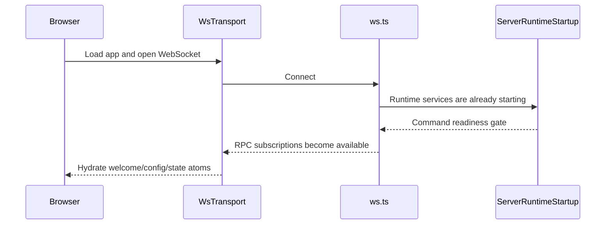
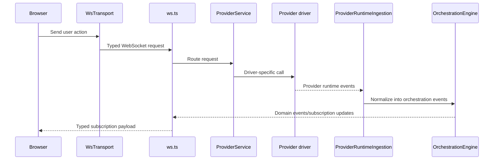
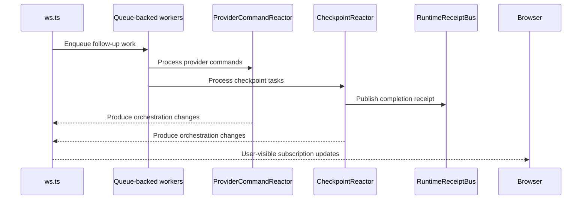

# Architecture

Atelier runs as a **Node.js HTTP/WebSocket server** with a React web client. The server owns project state, provider sessions, terminals, source control, workspace file access, auth, and persistence. In production it also serves the built web app.

```
┌─────────────────────────────────┐
│  Browser / Electron renderer    │
│  React + Vite web app           │
│  wsTransport + wsRpcClient      │
└──────────┬──────────────────────┘
           │ ws://localhost:3773
┌──────────▼──────────────────────┐
│  apps/server (Node.js)          │
│  HTTP + Effect RPC over WS      │
│  ServerRuntimeStartup           │
│  OrchestrationEngine            │
│  ProviderService                │
│  CheckpointReactor              │
│  RuntimeReceiptBus              │
└──────────┬──────────────────────┘
           │ provider-specific adapters
┌──────────▼─────────────────────────────────┐
│  Codex / Claude / Cursor / OpenCode CLIs   │
└────────────────────────────────────────────┘
```

## Components

- **Browser app**: The React app renders session state, owns the client-side WebSocket RPC transport, and treats contract-decoded subscription events as the boundary between server runtime details and UI state.

- **Server**: `apps/server` is the main coordinator. It serves HTTP endpoints and the WebSocket RPC surface, waits for runtime startup readiness before accepting command work, and exposes subscriptions for shell/thread state, terminals, providers, settings, keybindings, and diagnostics.

- **Provider runtime**: built-in drivers wrap Codex, Claude Code, Cursor Agent, and OpenCode. Each driver translates provider-native events into the app's orchestration model.

- **Background workers**: Long-running async flows such as runtime ingestion, command reaction, and checkpoint processing run as queue-backed workers. This keeps work ordered, reduces timing races, and gives tests a deterministic way to wait for the system to go idle.

- **Runtime signals**: The server emits lightweight typed receipts when important async milestones finish, such as checkpoint capture, diff finalization, or a turn becoming fully quiescent. Tests and orchestration code wait on these signals instead of polling internal state.

## Event Lifecycle

### Startup and client connect



1. The browser boots [`WsTransport`][1] and [`wsRpcClient`][2].
2. The server accepts the connection in [`ws.ts`][3] using the shared RPC contracts in [`rpc.ts`][6].
3. [`ServerRuntimeStartup`][4] gates command execution until startup work such as settings, keybindings, providers, git fetch, and project bootstrap has settled.
4. The client subscribes to server state and domain streams, then hydrates local atoms from those subscription payloads.

### User turn flow



1. A user action in the browser becomes a typed request through [`WsTransport`][1] and [`wsRpcClient`][2].
2. [`ws.ts`][3] decodes that request using the shared RPC contracts in [`rpc.ts`][6] and routes it to the right service.
3. [`ProviderService`][8] starts or resumes a session and talks to the selected provider instance.
4. Provider-native events are pulled back into the server by [`ProviderRuntimeIngestion`][9], which converts them into orchestration events.
5. [`OrchestrationEngine`][10] persists those events, updates the read model, and exposes them as domain events.
6. The browser receives updated shell/thread state through orchestration subscriptions defined in [`orchestration.ts`][11].

### Async completion flow



1. Some work continues after the initial request returns, especially in [`ProviderRuntimeIngestion`][9], [`ProviderCommandReactor`][13], and [`CheckpointReactor`][14].
2. These flows run as queue-backed workers using [`DrainableWorker`][16], which helps keep side effects ordered and test synchronization deterministic.
3. When a milestone completes, the server emits a typed receipt on [`RuntimeReceiptBus`][15], such as checkpoint completion or turn quiescence.
4. Tests and orchestration code wait on those receipts instead of polling git state, projections, or timers.
5. Any user-visible state changes produced by that async work still go back through [`ws.ts`][3] subscriptions.

[1]: ../apps/web/src/rpc/wsTransport.ts
[2]: ../apps/web/src/rpc/wsRpcClient.ts
[3]: ../apps/server/src/ws.ts
[4]: ../apps/server/src/serverRuntimeStartup.ts
[6]: ../packages/contracts/src/rpc.ts
[7]: ../apps/server/src/server.ts
[8]: ../apps/server/src/provider/Layers/ProviderService.ts
[9]: ../apps/server/src/orchestration/Layers/ProviderRuntimeIngestion.ts
[10]: ../apps/server/src/orchestration/Layers/OrchestrationEngine.ts
[11]: ../packages/contracts/src/orchestration.ts
[13]: ../apps/server/src/orchestration/Layers/ProviderCommandReactor.ts
[14]: ../apps/server/src/orchestration/Layers/CheckpointReactor.ts
[15]: ../apps/server/src/orchestration/Layers/RuntimeReceiptBus.ts
[16]: ../packages/shared/src/DrainableWorker.ts
